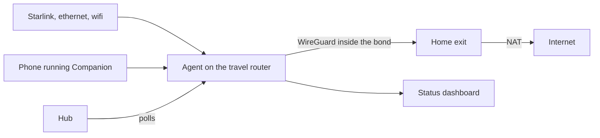

# Zippie

Self-hosted multipath internet bonding that exits at your own home uplink.

Last checked against the code: 2026-11-01.

Zippie spreads traffic across every link a traveling household has, such as
Starlink, hotel ethernet, repeated wifi and phones, and reassembles it at one
exit. It runs on one travel router today: see [Status](#status). Device
identity lives in [muster](https://github.com/quadseven/muster).

## What it does

- Keeps connections up when a link dies. Address-loss failover measured in the
  tens of milliseconds on 2026-09-01; a captive portal or half-dead wifi waits
  for the probes.
- A phone running the Companion app on the router's wifi becomes a leg when
  present and stops being one when absent, on both iPhone and Android.
- Bonded uplink is limited by the sum of travel links. Downlink is also limited
  by the home uplink and server NIC.

## Quick start

The installers read files from the checkout, so `curl | bash` fails. Debian or
Ubuntu at home, Raspberry Pi OS or Debian on the road. Unverified: neither
installer was run for this check, and the live exit does not use them.

```bash
git clone https://github.com/quadseven/zippie && cd zippie

# Home server. Forward UDP 51820 at the home gateway.
sudo scripts/install-home.sh
sudo zippie-home init --public-endpoint home.example.com
sudo zippie-home up
sudo zippie-home add-client travel-pi

# Travel client
sudo scripts/install-travel.sh
sudo zippie import /path/to/travel-pi.client.json
sudo zippie up
```

The GL-MT3000 is the primary target. See
[travel/gl-mt3000/README.md](travel/gl-mt3000/README.md).

## How it works



The agent in `travel/bond-agent/` watches each leg and sends packets across
them. WireGuard encrypts once, above the bond; the home end reorders packets,
recovers losses and passes them to its WireGuard server. It uses Noise_IK.
Keys live in `/var/lib/zippie/`. [ARCHITECTURE.md](ARCHITECTURE.md) follows one
packet end to end.

`prefer` mode (default) uses one path and `aggregate` mode uses all healthy
ones; the live router runs aggregate. See
[docs/path-selection.md](docs/path-selection.md).
[docs/openmptcprouter.md](docs/openmptcprouter.md) covers the optional
OpenMPTCProuter route. The agent serves the dashboard on `:8787/`.

## Run and test locally

The offline proof needs no root and no real WANs: `./scripts/smoke-test.sh` or
`make smoke`.

To compare live devices with a checkout, run
`python3 scripts/check-device-drift.py <status-url>`. The nightly workflow
reads the same URLs from `ZIPPIE_STATUS_URLS`.

## How to test

These are the core pull request checks, from the repo root. AGENTS.md lists the
rest. On macOS, 14 `test_transport.py` tests fail because Python there has no
`SO_BINDTODEVICE`; CI runs Linux and is the judge.

```bash
uvx ruff@0.15.10 check . && uvx ruff@0.15.10 format --check .
(cd travel/datapath-go && go vet ./... && go test ./... -race -count=1)
(cd travel/bond-agent && uv run --with 'pytest>=8.0' --with tomli \
  --python 3.9 python -m pytest -q)
bash scripts/check-no-operator-hosts.sh --self-test
bash scripts/check-no-operator-hosts.sh
python3 travel/bond-agent/tests/test_readme_standard.py
```

## Configuration

The agent reads `/etc/zippie/zippie.toml`. Start from
[configs/examples/zippie.toml](configs/examples/zippie.toml). Set the home
endpoint, its UDP ports and one `[[paths]]` entry per link.
`dashboard_host` must be set under `[agent]`; at top level it is ignored.

Nothing ships with the repo: bring a router, a home exit with inbound UDP, and
USB-C power for phones ([why](docs/hardware.md#powering-phone-legs)).
[docs/setup-reference.md](docs/setup-reference.md) holds the older long text.

## Status

- Live: the GL-MT3000 travel router, plus `zippie-home` and `zippie-hub` as
  pods in a private Kubernetes cluster (both 1/1 on 2026-11-01). The exit pod
  uses host networking, so `home/bond-server/` systemd setup is not what runs.
- Android: Zippie Companion (`app.zippie.companion`) is in Google Play
  Production, last updated 2026-08-18, per the operator. `app.muster.agent` is
  also registered. Neither has a public store page (404 on 2026-11-01). The
  Production version and which phones take it are unverified.
- iOS: TestFlight only. Last upload run 2026-09-22.
- Stubbed: the dashboard data-cap bar shows typed-in numbers.
- Parked: `zippie-clienthome`, which has no running pod.
- Retired: the Fleet MDM (2026-10-16; `fleet/` is history) and the UniFi UTR as
  primary target. Failing on `main` on 2026-11-01: the nightly device drift
  check and the last agent test run. Cause unverified.

Open work: [goal issue](https://github.com/quadseven/zippie/issues/205).
Measurements: [docs/state-of-play.md](docs/state-of-play.md). Conventions:
[docs/agents/issue-tracker.md](docs/agents/issue-tracker.md).

## How it deploys

A merge deploys two things. There is no staging device.

| Change | After a merge |
|---|---|
| `travel/**` except docs and tests, `scripts/deploy-openwrt.sh` | `deploy.travel-router.yml` deploys to the live router and restarts the bond |
| `deploy/oke/**` | `deploy.oke-manifests.yml` applies to the cluster and rolls the home pod; it also reconciles every 6 hours |
| `travel/datapath-go/**`, `deploy/oke/zippie-clienthome/**` | `build.clienthome-image.yml` publishes an image and deploys nothing |
| `companion/`, `companion-android/` | Nothing ships |

TestFlight and the Android APK and bundle are manual dispatches. No workflow
uploads to Google Play, so a Play release is a manual console upload.

## Contributing

Changes land through a pull request. `zippie datapath go test` and
`Grug - Chief` are the required checks; review by `grug-tribe[bot]` and the leak
scan also run. Read [AGENTS.md](AGENTS.md) first: this repository is public,
and the router's only uplink is the bond itself.

## Layout

```
travel/bond-agent/   multipath agent (Python 3.9)
travel/datapath-go/  Go datapath and mobile bind module
travel/gl-mt3000/    router scripts and rollback
travel/rpi/, travel/unifi-utr/  older target notes
home/bond-server/    self-hosted home exit
deploy/oke/          Kubernetes manifests; targets.tsv lists what deploys
hub/                 hub page for every node
dashboard/           status UI served by the agent
companion/           iOS app
companion-android/   Android app
design/              tokens and icon generator
fleet/               retired MDM policy fragments
configs/, scripts/   samples, installers, deploy, guards
```

## Docs

- [ARCHITECTURE.md](ARCHITECTURE.md): the system and a packet's path.
- [DECISIONS.md](DECISIONS.md): decisions and the incidents behind them.
- [CONTEXT.md](CONTEXT.md): the vocabulary.
- [docs/](docs/architecture.md): design notes, runbook and hardware guides.

## License

AGPL-3.0. Not affiliated with GL.iNet or any commercial bonding vendor.
