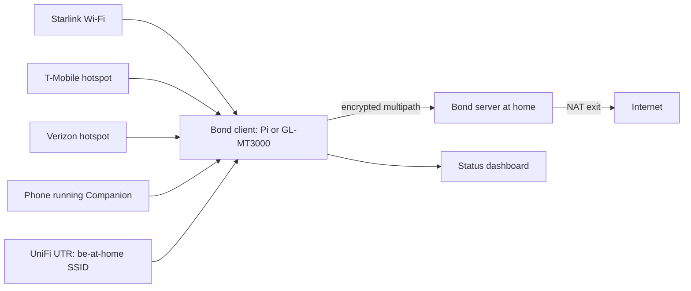

# Zippie

Self-hosted multipath internet bonding that exits at your own home uplink.

Zippie aggregates Starlink, T-Mobile, Verizon and anything else into one
resilient tunnel that exits at **your own home uplink**. No commercial bonding
license. Your pipes, your box, your traffic. It is built for a personal
home-exit kit: a Raspberry Pi or GL-MT3000 travel router, with a UniFi UTR
behind it.

Device identity is deliberately not solved in this repo, after a deploy
pipeline splicing a static key into a router config caused an outage. It lives
in [muster](https://github.com/quadseven/muster).

## What it does

With Starlink and two cellular paths:

1. Any single path death is sub-second failover (policy-driven).
2. Lossy Starlink rain fade: the agent de-weights it or switches to cellular.
3. Hotel captive portals: the path is marked down until the portal is cleared;
   the others carry traffic.
4. A phone running the Companion relay app on the router's Wi-Fi becomes a
   leg when it is present and stops being one when it is absent, with no
   configuration step either way. Both iPhone and Android announce.
5. The home uplink is the single high-capacity exit: bonded uplink is limited
   by the **sum of travel WANs**, downlink by **min(sum of travel WANs, home
   uplink, server NIC)**.

| Typical commercial bonding | Zippie |
|---|---|
| Per-router / seat license | Free, self-hosted |
| Vendor cloud exit nodes | **Your own** home exit (low latency to home, full rate) |
| Black-box bonding | Inspectable agent + WireGuard + optional OpenMPTCProuter |
| Extra SKU for travel routers | Designed for Pi, GL-MT3000, UniFi UTR |

## Quick start

### 1. Home server (once)

```bash
# On a Debian/Ubuntu box at home with internet via a home fiber uplink:
curl -fsSL https://raw.githubusercontent.com/quadseven/zippie/main/scripts/install-home.sh \
  | sudo bash
sudo zippie-home init --public-endpoint home.example.com:51820
sudo zippie-home add-client travel-pi
# Save the printed client bundle (or pull from /var/lib/zippie/clients/)
```

Port-forward on your home gateway:

- UDP `51820` (path 0 default)
- UDP `51821`..`51823` if you pin one UDP port per path (optional, helps
  some CGNAT paths)

### 2. Travel client (Pi)

```bash
# On the Pi:
curl -fsSL https://raw.githubusercontent.com/quadseven/zippie/main/scripts/install-travel.sh \
  | sudo bash
sudo zippie import /path/to/travel-pi.client.json
sudo zippie up
zippie status
```

### 3. GL-MT3000

See [travel/gl-mt3000/README.md](travel/gl-mt3000/README.md). Short version:
enable multi-WAN, install WireGuard, drop in generated configs, run the agent
package.

### 4. UniFi UTR "be at home"

Wire the UTR WAN into the bond client's LAN. Clients on the UTR get home-exit
IP space and optional site-to-site to your home UniFi. Details:
[travel/unifi-utr/README.md](travel/unifi-utr/README.md).

## How it works



The **bond client** (the agent in `travel/bond-agent/`) joins each WAN, probes
it, and carries traffic to the **bond server** (`home/bond-server/`) over one
WireGuard tunnel per path. The server only accepts provisioned peers and NATs
the traffic out of the home uplink. The UniFi UTR sits on the client's LAN so
travel devices see the home network. The agent serves the status dashboard.
[ARCHITECTURE.md](ARCHITECTURE.md) follows one packet end to end.

### Two operating modes

**1. Zippie agent (default, this repo).** A lightweight multipath stack you
control end-to-end:

- One **WireGuard** tunnel per WAN path back to home
- Continuous **latency / loss** probes
- **`prefer` mode (default):** one active path - health, data-cap soft
  limits, `cost_class`, then priority (pick the single best link)
- **`aggregate` mode:** weighted multipath across healthy paths (max
  multi-flow speed)
- Works on Raspberry Pi OS, Debian, and GL.iNet (OpenWrt)

Best for: always-up travel with Starlink + several 50GB phone lines (Operator
+ Co-operator) without burning every cap at once. Details:
[docs/path-selection.md](docs/path-selection.md).

**2. OpenMPTCProuter (optional, true single-flow bonding).** When you need
**true MPTCP channel bonding** of a single TCP stream, so one download spans
several WANs at once:

- Home: OMR server install on an always-on box with a public IP or
  port-forward at the home gateway
- Travel: OMR OpenWrt image on Pi (or custom build for MT3000-class hardware)

See [docs/openmptcprouter.md](docs/openmptcprouter.md). Zippie can sit in
front as WAN health / SSID joiner even when OMR owns the tunnels.

### Status dashboard

```bash
# the agent serves it; it does not run standalone
ssh root@<router> '/etc/init.d/zippie start'
```

- Local: `http://<router-tailnet-ip>:8787/`
- Fronted at `zippie.<your-tailnet-domain>` via a Caddy wildcard for
  `*.<your-tailnet-domain>`.

It shows per-path RTT, loss, bytes, weight, tier and which path is primary.
The cap bar is currently a **placeholder**; see
[docs/state-of-play.md](docs/state-of-play.md).

`tailscale serve` cannot host the custom name: it only terminates TLS for the
node's own `*.ts.net` MagicDNS name, and GL's admin nginx already owns
`0.0.0.0:443` on this router. `dashboard_host` must be set under `[agent]`;
at top level it is silently ignored.

### Security

- All path traffic is **WireGuard** (Noise_IK, modern crypto).
- The home server only accepts provisioned peer public keys.
- Keys live in `/var/lib/zippie/` (0600). Never commit real keys.
- Optional: lock home `AllowedIPs` and use a separate LAN for travel exit.

## Run and test locally

The offline proof needs no root and no real WANs:

```bash
./scripts/smoke-test.sh   # or: make smoke
```

It runs home provision -> 3 per-path WireGuard peers -> client import ->
aggregate multipath -> Starlink-down failover -> degraded reweight ->
dashboard `/api/status`. See [docs/tailnet-home.md](docs/tailnet-home.md) for
how this pairs with your own Tailscale / Kubernetes hosts.

These are the commands CI runs on a pull request, from the repo root:

```bash
# check.python-lint.yml (any .py change)
uvx ruff@0.15.10 check .
uvx ruff@0.15.10 format --check .

# check.agent-tests.yml (agent, hub and deploy tooling)
(cd travel/bond-agent && uv run --with 'pytest>=8.0' --with tomli \
  --python 3.9 python -m pytest -q \
  --basetemp="${RUNNER_TEMP:-/tmp}/zippie-pytest")
(cd hub && uv run --with 'pytest>=9.0.3' --with pyyaml --python 3.12 \
  python -m pytest -q)
(cd deploy/oke && uv run --with 'pytest>=9.0.3' --python 3.12 \
  python -m pytest -q)
node hub/tests/hub_js.mjs

# check.agent-tests.yml (Go datapath)
(cd travel/datapath-go && go vet ./... && go test ./... -race -count=1 \
  && go test ./zippie/ -run 'Fuzz' -count=1)
(cd travel/datapath-go/mobile && go test ./... -race -count=1)

# check.operator-hosts.yml (every pull request)
bash scripts/check-no-operator-hosts.sh --self-test
bash scripts/check-no-operator-hosts.sh
python3 travel/bond-agent/tests/test_readme_standard.py

# check.design-tokens.yml (design/ or generated tokens)
python3 design/generate.py --check

# check.android.yml (companion-android/)
(cd companion-android && ./gradlew --no-daemon testDebugUnitTest \
  && ./gradlew --no-daemon assembleDebug)
```

The iOS companion builds on a macOS runner with Xcode
(`app.companion-ios.ci.yml`), and `check.leak-scan.yml` scans every pull
request's diff and text. [`.loom/validation.conf`](.loom/validation.conf)
holds the core lint and test line in one command.

### Device drift check

Run `python3 scripts/check-device-drift.py <status-url> ...` from a checkout
of `main` to compare live devices with that same checkout. See
[`scripts/device-drift.env.example`](scripts/device-drift.env.example) for
the scheduled workflow's `ZIPPIE_STATUS_URLS` setting. The workflow requires
your own self-hosted runner with tailnet access and a repository secret
containing the device status URLs. Device-side GitHub credentials are
optional. See [`docs/coldboot-testing.md`](docs/coldboot-testing.md) for
result semantics.

## Configuration

`/etc/zippie/zippie.toml` (a full sample is in
[`configs/examples/zippie.toml`](configs/examples/zippie.toml)):

```toml
[home]
endpoint = "home.example.com"   # Dynamic DNS to your home public IP
# one UDP port per path (recommended) OR single port with multi-peer
ports = [51820, 51821, 51822, 51823]

[policy]
mode = "prefer"  # prefer (one path) | aggregate (multipath) | redundant
probe_interval_ms = 500

[[paths]]
name = "starlink"
priority = 10
cost_class = "metered"
monthly_cap_gb = 50
match = { type = "ssid", ssid = "STARLINK" }

[[paths]]
name = "verizon"
priority = 30
cost_class = "throttle_ok"  # still usable after soft cap
monthly_cap_gb = 50
match = { type = "ssid", ssid = "PHONE-VZ" }
```

What you bring (none of it ships with the repo):

| Role | Device | Notes |
|---|---|---|
| Bond client (recommended) | Raspberry Pi 4/5 | USB NICs / Wi-Fi dongles for extra WANs |
| Compact bond client | [GL-MT3000 (Beryl AX)](https://www.gl-inet.com/en-us/products/gl-mt3000) | Dual-band Wi-Fi 6, OpenWrt-based; multi-WAN + WireGuard native. **One** USB port (the 2.0 and 3.0 buses share one connector) |
| Travel LAN / "home remotely" | UniFi UTR | Put behind the bond client; clients join UTR as if at home |
| WAN sources | Starlink, phone hotspots (T-Mo, VZ) | Agent auto-joins preferred SSIDs |
| **Phone legs** | iPhone / Android on the router's wifi | Run the Companion relay; the phone lends its cellular. **Both platforms announce**; a phone that is present is a leg and a phone that is absent is not |
| **Phone power** | USB-C PD source, not the router | The router cannot keep a relaying phone charged ([why](docs/hardware.md#powering-phone-legs)) |
| Bond server | Mini PC / Pi / NUC on the home LAN | Port-forward UDP 51820+; 2.5G NIC preferred |

Why phones need their own supply, and which cable to buy, is in
[docs/hardware.md](docs/hardware.md#powering-phone-legs).

## Status

Open work is tracked in the
[goal issue](https://github.com/quadseven/zippie/issues/205).
What was last measured on the live router, the known-broken list and the
traps already paid for are in [docs/state-of-play.md](docs/state-of-play.md),
dated at each section. Older issue history was migrated in from an earlier
internal tracker; [docs/agents/issue-tracker.md](docs/agents/issue-tracker.md)
has the epic and sub-issue conventions it left behind.

## Contributing

Changes land through a pull request; direct pushes to `main` are refused.
A pull request must pass the leak scan, the operator-hosts ratchet, the
suites above that its paths trigger, and review by `grug-tribe[bot]`.

Read [AGENTS.md](AGENTS.md) first: this repository is public, and the
router's only uplink is the bond this code implements, so a broken change
removes the way to fix it. That file is the short list of what has already
gone wrong.

## Docs

- [ARCHITECTURE.md](ARCHITECTURE.md) - what the system is, why the problem is
  hard, and how a packet moves from a client on the travel LAN to the home
  exit and back.
- [DECISIONS.md](DECISIONS.md) - the decisions that shaped it, each with the
  incident that caused it.
- [CONTEXT.md](CONTEXT.md) - the vocabulary. `leg`, `bond`, `carrying` and
  `announce` mean exactly one thing each, in the code and in the logs.
- [docs/architecture.md](docs/architecture.md) - the start of the docs tree:
  architecture, threat model, OMR guide.

### Repo layout

```
zippie/
  home/bond-server/     # home exit: WireGuard multipath + NAT + provisioning
  travel/bond-agent/    # multipath control plane (Python)
  travel/datapath-go/   # Go packet datapath and its mobile bind module
  travel/rpi/           # Pi image notes + netplan / NetworkManager helpers
  travel/gl-mt3000/     # GL.iNet / OpenWrt configs
  travel/unifi-utr/     # UTR topology + site-to-site notes
  companion/            # iOS Companion relay app
  companion-android/    # Android Companion relay app
  hub/                  # control-plane hub for every zippie node
  deploy/oke/           # Kubernetes manifests and operator tooling
  design/               # design tokens and icon generator
  dashboard/            # tiny status UI served by the agent
  configs/examples/     # sample zippie.toml + SSID profiles
  scripts/              # installers, smoke test, guards
  docs/                 # architecture, threat model, OMR guide
```

## License

MIT. Not affiliated with GL.iNet or any commercial bonding vendor.
